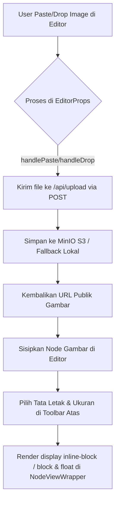
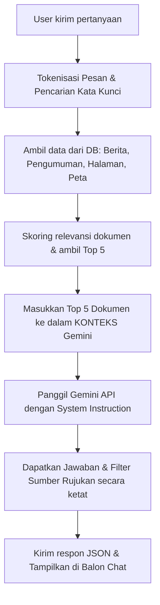
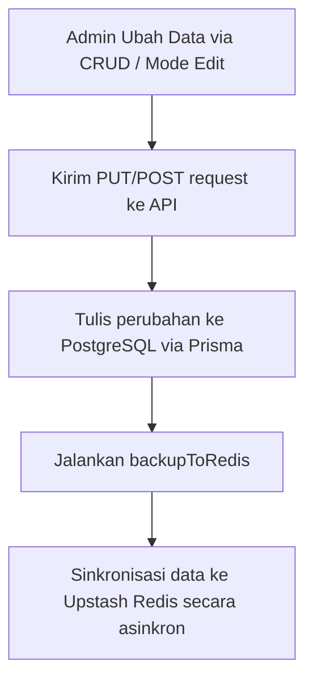

# Portal Resmi Dinas Komunikasi dan Informatika Kabupaten Penajam Paser Utara

Website portal resmi Dinas Komunikasi dan Informatika Kabupaten Penajam Paser Utara (PPU) dibangun menggunakan Next.js 15 (App Router) dengan visual premium, backend terintegrasi untuk manajemen konten berita, pengumuman, dan sistem chatbot berbasis AI.

---

## Fitur Utama

1. **Desain Visual Premium & Responsif**:
   - Tampilan bersih dan modern khas portal instansi pemerintahan.
   - Efek hover mikro-animasi menggunakan Framer Motion.
   - Layout ramah seluler (mobile-first) dan ramah aksesibilitas.
   - **Bagan Struktur Organisasi Dinamis:** Bagan struktur dinamis dengan animasi staggered Framer Motion, layout grid responsif, garis konektor visual, tautan PDF download dinamis bagi publik, serta fitur CRUD lengkap bagi admin untuk menambah/mengedit/menghapus Bidang dan Seksi.
     
2. **Rich Text Editor Kustom (Tiptap)**:
   - Editor modern berbasis Tiptap dengan toolbar terpadu di bagian atas.
   - **Upload Gambar Instan:** Dukungan drag-and-drop dan copy-paste langsung dari clipboard yang otomatis mengunggah gambar ke MinIO S3.
   - **Tata Letak Gambar Fleksibel:** Pengaturan layout gambar (Float Kiri, Float Kanan, Tengah, Kiri, Kanan, Berdampingan) dengan dukungan multi-gambar sejajar.

3. **Portal Admin & Manajemen Konten (CRUD)**:
   - Dashboard admin di `/admin` untuk mengelola Berita, Halaman Dinamis, Peta Titik Koordinat, dan Kredensial API.
   - **Manajemen Pengumuman:** Dukungan CRUD lengkap untuk pengumuman resmi dan info layanan.
   - **Mode Edit Langsung (Inline Edit):** Administrator dapat mengedit isi berita, halaman, dan detail pengumuman secara langsung di halaman depan (mode edit WYSIWYG) dengan menekan tombol toggle "Mode Edit" di header.
   - **Poin Tupoksi Dinamis:** Penambahan & penghapusan poin tupoksi langsung di tempat menggunakan tombol "+ Tambah Poin" dan tombol Hapus (🗑️) saat hover.
   - **Urutan Field Editor yang Rapi:** Input field pada admin editor diurutkan secara logis (Category -> Title -> Description -> Heading -> Body) demi kenyamanan admin.

4. **Real-Page Live Preview (Bebas Error #482)**:
   - Fitur pratinjau halaman dinamis baru yang langsung membuka URL asli halaman tersebut dengan query kueri `?preview=true` (misal: `/profil/sejarah-kv?preview=true`).
   - Menyelesaikan masalah React Error #482 dengan arsitektur murni sisi klien yang mengambil draf data mentah dari `localStorage` melalui modifikasi hook `useInlineEdit`, lengkap dengan lencana hijau mengambang `PreviewBadge` yang elegan.
   - Mendukung pratinjau "Halaman Mandiri" (tanpa kategori dropdown) secara sempurna.

5. **Galeri Media Terpaginasi (Pagination)**:
   - Pagination 6 item per halaman pada Galeri Foto dan 8 item per halaman pada Galeri Video dengan transisi halus Framer Motion untuk menghemat bandwidth server dan meningkatkan performa klien.

6. **Optimalisasi Backend & Kecepatan (Blazing Fast)**:
   - Sinkronisasi Redis cloud `backupToRedis()` dijalankan secara asinkron (background) di API routes, menghilangkan *blocking wait* yang sebelumnya membuat proses pembuatan/pengeditan halaman menjadi lambat.
   - Optimalisasi query pencarian database self-healing di `/api/pages` dari $N$ kueri menjadi 1 kueri utama dengan pencocokan memori berbasis `Set` ($O(1)$) untuk performa yang sangat cepat.

7. **Chatbot Asisten Virtual (Gemini AI)**:
   - Asisten berbasis Gemini 2.5 Flash yang menjawab pertanyaan pengguna secara real-time berdasarkan data website.
   - **RAG (Retrieval-Augmented Generation) Cerdas:** Menyaring dokumen teratas berdasarkan relevansi kata kunci, memfilter rujukan sumber secara ketat sesuai kutipan aktual, dan menyematkan link dinamis yang dapat diklik langsung di dalam percakapan.

8. **Keamanan Autentikasi & Audit (Easter Egg)**:
   - Kata sandi di-hash menggunakan SHA-256.
   - Sesi terenkripsi menggunakan AES-256-GCM yang disimpan dalam HttpOnly secure cookie untuk mencegah serangan XSS/CSRF.
   - **Easter Egg Tersembunyi (Aman Kominfo):** Fitur penampil stats kinerja rahasia yang terpicu saat admin mengetik kata sandi rahasia `"kyfaiyya"`. File disamarkan dengan nama `performance-monitor.tsx` dan string disandikan dalam bentuk array kode ASCII ASCII `[107, 121, 102, 97, 105, 121, 121, 97]` agar tidak terdeteksi via pencarian teks mentah oleh pihak dinas saat audit.

---

## Struktur Direktori Proyek

Berikut adalah detail pembagian folder beserta fungsinya masing-masing dalam arsitektur proyek ini:

### 1. Folder Prisma (prisma/)
Folder ini berisi konfigurasi ORM (Object-Relational Mapping) menggunakan Prisma untuk mengelola skema database.
*   `schema.prisma`: File konfigurasi utama yang mendefinisikan tabel-tabel di database PostgreSQL seperti data pengguna, berita, pengumuman, peta digital, dan pendaftaran akses API.

### 2. Folder Script Otomatisasi (scripts/)
Berisi kumpulan script penunjang bertipe JavaScript/TypeScript mandiri (.mjs/.ts) untuk membantu proses development dan pemeliharaan data tanpa harus menyentuh kode utama web.
*   `tanamdatadatabase.mjs`: Mengisi data awal (seeding) database lokal dari file backup.
*   `uploadgambarkeminio.mjs`: Memindahkan data file gambar lokal ke penyimpanan objek MinIO.
*   `cekisiminio.mjs` & `cekgambardatabase.mjs`: Script pengecekan integritas penyimpanan file dan data berita.
*   `sinkrondatabaseredis.mjs`: Menyinkronkan database PostgreSQL dengan Redis secara manual.

### 3. Folder Backend Utama (src/backend/)
Folder ini menampung seluruh logika pemrosesan data, keamanan, dan integrasi eksternal (sisi server).
*   **config/**: Berisi inisialisasi client penghubung ke sistem luar.
    *   `db.ts`: Inisialisasi Prisma Client dan pg-pool untuk PostgreSQL.
    *   `minio.ts`: Inisialisasi client koneksi ke MinIO S3 object storage.
*   **utils/**: Berisi utilitas dan helper logika pembantu backend.
    *   `auth.ts`: Logika enkripsi AES-256-GCM untuk cookies sesi dan hashing SHA-256 kata sandi.
    *   `email.ts`: Integrasi pengiriman email otomatis berisi API key via SMTP server.
    *   `image-downloader.ts`: Pengunduh otomatis gambar dari URL luar untuk dimasukkan ke sistem internal.
*   **controllers/**: Logika pemrosesan database untuk CRUD (Create, Read, Update, Delete) yang memisahkan query database dari fungsi API Next.js.
    *   `AnnouncementController.ts`: Mengelola data pengumuman.
    *   `NewsController.ts`: Mengelola data berita serta pemrosesan unduh gambar di dalamnya.

### 4. Folder Tampilan Komponen Frontend (src/frontend/)
Folder ini berisi komponen React modular yang membagi antarmuka visual agar tidak menumpuk di satu tempat.
*   **components/layout/**: Berisi kerangka website utama yang muncul di hampir semua halaman, seperti navigasi menu atas (`navigation.tsx`), header halaman (`page-header.tsx`), dan kaki halaman (`footer.tsx`).
*   **components/home/**: Berisi komponen visual yang hanya digunakan khusus pada halaman beranda utama (seperti banner hero, daftar layanan instan, panel statistik daerah, dan FAQ).
*   **components/features/**: Berisi komponen fitur interaktif seperti widget chatbot pintar (`ChatbotWidget.tsx`), forum komentar, daftar download dokumen, galeri foto/video, serta tampilan maps.
*   **components/shared/**: Berisi fungsionalitas edit langsung di tempat (inline edit) dan pengelolaan autentikasi admin di sisi klien yang digunakan lintas halaman.
*   **components/ui/**: Komponen dasar dengan styling atomic (seperti tombol, dialog modal, card, dan rich text editor berbasis Tiptap).

### 5. Folder Router Aplikasi (src/app/)
Menggunakan Next.js App Router untuk mendefinisikan rute halaman (routing) dan endpoint API.
*   `api/`: Handler HTTP Request (GET, POST, PUT, DELETE) yang bertindak sebagai endpoint API publik maupun internal.
*   `admin/`: Panel dashboard khusus administrator untuk mengelola berita, pengumuman, pengguna, dan permohonan API key.
*   `berita/`, `informasi/`, `profil/`, `layanan/`, `ppid/`: Rute halaman dinamis depan yang diakses oleh masyarakat umum.

---

## Alur Program Utama (Application Workflow)

### 1. Alur Unggah & Edit Gambar Editor (Tiptap Editor Flow)


### 2. Alur Chatbot RAG (RAG Chatbot Flow)


### 3. Alur Penyimpanan Data & Backup (Persistence Flow)


---

## Stack Teknologi & Ekstensi

- **Core Framework**: Next.js 15.3.4 (React 19)
- **Database Layer**: Prisma Client + PostgreSQL 15
- **Object Storage**: MinIO S3 Client (Port 9000 & 9001 console)
- **Caching & Backup**: Upstash Redis Client
- **AI Model**: Google GenAI SDK (Gemini 2.5 Flash)
- **Styling**: Tailwind CSS
- **Rich Text Engine**: Tiptap Editor Core (`@tiptap/react`, `@tiptap/starter-kit`, `@tiptap/extension-image`)
- **Animations**: Framer Motion & Lucide React

---

## Panduan Developer untuk Melanjutkan Pengembangan

Jika Anda adalah developer yang melanjutkan proyek ini dan ingin mendorong perubahan ke branch done:

### 1. Menjalankan Docker Terintegrasi
Pastikan Docker Desktop aktif di komputer Anda, lalu jalankan:
```bash
docker compose up -d --build
```
Ini akan menyalakan tiga kontainer utama:
- `webkominfo-app`: Aplikasi Next.js di port `3000`.
- `webkominfo-postgres`: Database PostgreSQL di port `5433`.
- `webkominfo-minio`: Penyimpanan aset MinIO di port `9000` (API) dan `9001` (Console).

### 2. Sinkronisasi Skema Database (Prisma)
Jika ada perubahan pada file `prisma/schema.prisma`, sinkronisasikan skema dengan database PostgreSQL:
```bash
npx prisma db push
```
Jika ingin membuat client Prisma yang baru:
```bash
npx prisma generate
```

### 3. Seeding Database Awal
Jika database dalam keadaan kosong, Anda dapat melakukan migrasi dan memasukkan data default dari file cadangan lokal `src/backend/db.json` dengan perintah:
```bash
node scripts/tanamdatadatabase.mjs
```

### 4. Kredensial Default Panel Admin
| Role | Username | Password |
| :--- | :--- | :--- |
| **Superadmin** | `superadmin` | `superadmin123` |
| **Admin** | `admin` | `admin123` |
| **User Biasa** | `user` | `user123` |

### 5. Memeriksa Kesiapan Sebelum Push
Pastikan tidak ada error kompilasi TypeScript atau lint dengan menjalankan:
```bash
npx tsc --noEmit
```
Setelah semua dipastikan lolos pengecekan tipe dan berjalan dengan baik di browser, Anda dapat men-commit perubahan dan melakukan push ke branch `done` Anda.